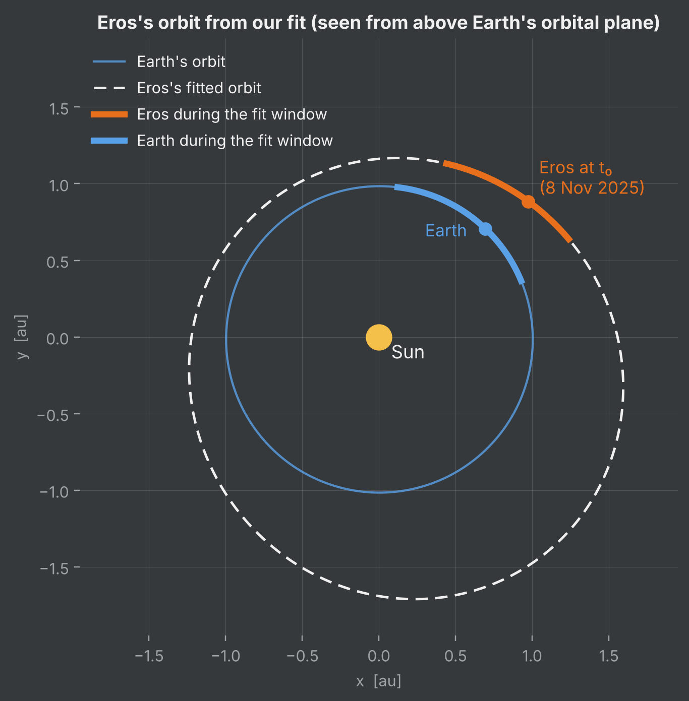
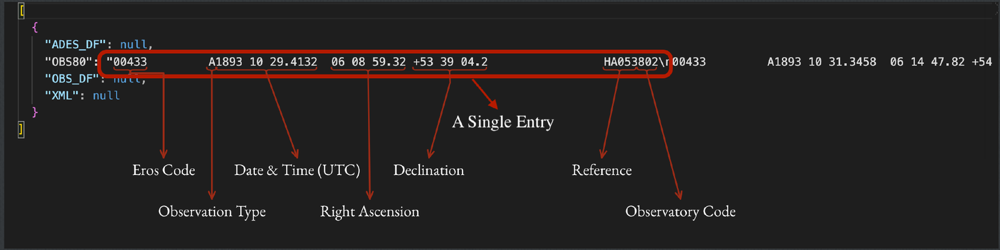
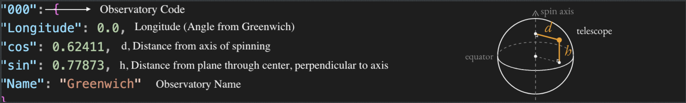
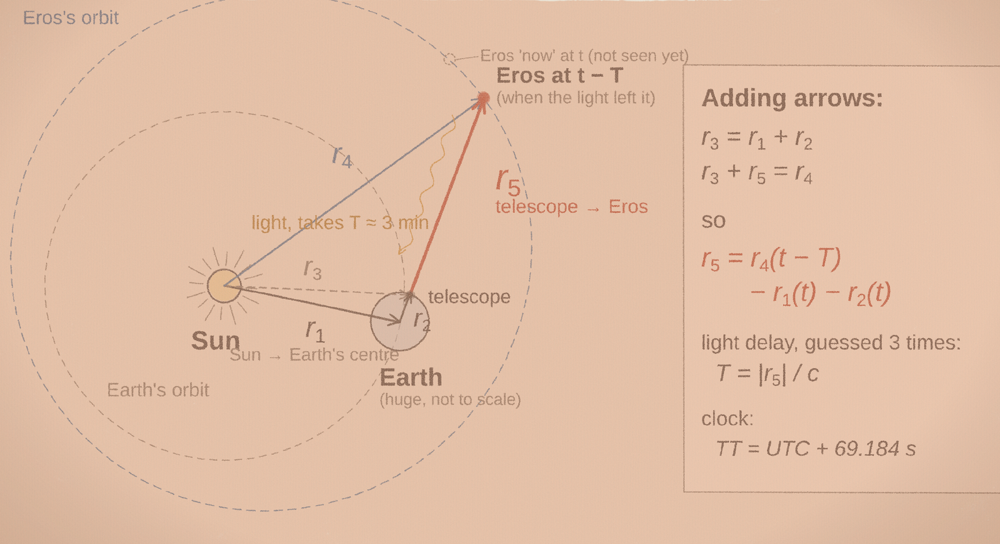
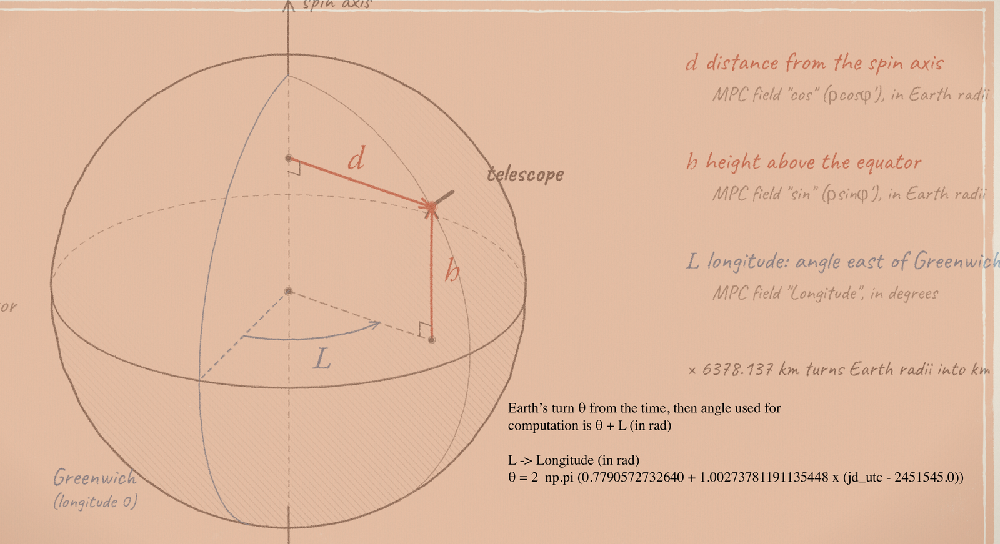
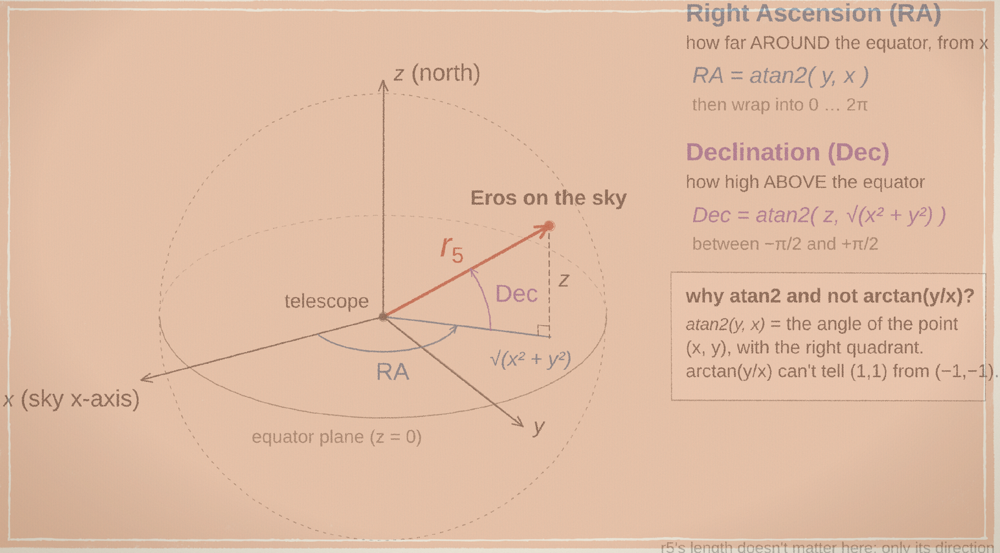
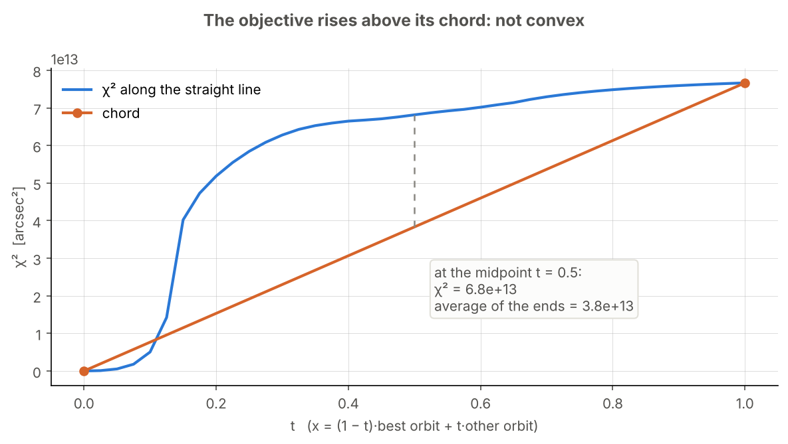
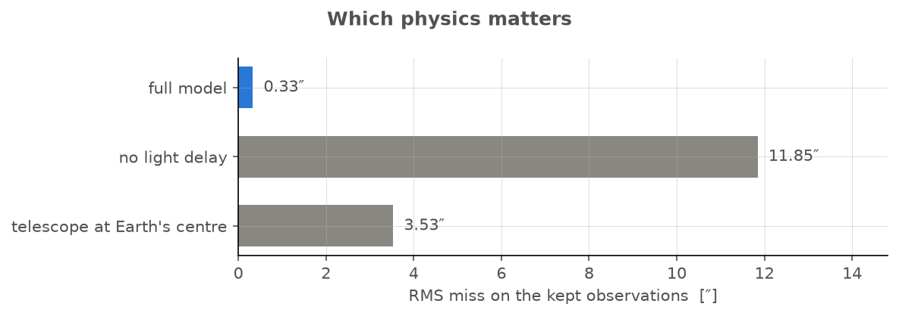

# Orbit Fitting using Real Telescopic Observations

Recovering the orbit of asteroid **433 Eros** from real telescope measurements, using Newton's law of gravitation and non-convex optimisation.

> A personal project. It also served as the non-convex (hard) formulation in my AIT 203 Optimization course project at IIIT Bangalore.



---

## The Dataset

- **Source:** IAU [Minor Planet Center](https://minorplanetcenter.net) (MPC) dataset.
- The dataset contains a total of **18,614** real observations, from 29/10/1893 to 19/09/2026.
- We perform orbit fitting in the **2025 close approach** window: 15/10/2025 to 15/12/2025.
- In this time frame we have **343 observations** from **11 observatories**:

| Obscode | C40 | D04 | Z36 | 006 | 703 | 233 | D76 | G11 | K83 | S24 | X76 |
|---|---|---|---|---|---|---|---|---|---|---|---|
| Observations | 168 | 119 | 25 | 8 | 4 | 4 | 3 | 3 | 3 | 3 | 3 |

## Data Extraction

`_fetch_data.py` is a script that extracts data from the following sources:

1. **Observations:** https://data.minorplanetcenter.net/api/get-obs
2. **Observatory Codes:** from the `mpc_obscodes` package

It stores the Observations and Obscodes in the `data/raw/` directory as:

1. `MPC_Observations_433Eros.json`
2. `MPC_Observatory_Codes.json`

## Data Formatting

`_process_data.py` extracts data from the two json files and stores it as separate numpy arrays, to be accessed directly in the helper modules that calculate the relative position between the telescope and Eros.

Our aim is to extract and store, for every observation: `jd_utc` (the observation time in UTC), the measured RA and Declination, and the telescope's Longitude (L), distance from the spin axis (d) and height from the equatorial plane (h). $\mathbf{r}_0$ and $\mathbf{v}_0$ are what we predict.

### `MPC_Observations_433Eros.json`



We extract:

1. Measured Right Ascension (stored as `ra`)
2. Measured Declination (stored as `dec`)
3. Date & Time (stored as `jd_utc`)
4. Observatory Code, used to look up the other json

### `MPC_Observatory_Codes.json`



Using the Obscode obtained previously, we look up the dict and get:

1. Longitude (stored as `L`)
2. Distance from the axis of spin, in Earth radii (stored as `d`)
3. Distance from the plane perpendicular to the axis of spin and passing through the centre (stored as `h`)

---

## Problem Statement

- **Find Eros's position $\mathbf{r}_0$ and velocity $\mathbf{v}_0$** around the Sun at a given time $t_0$ (8 Nov 2025), which fix its entire orbit under Newton's gravity.
- The problem is that telescope **measurements tell the direction** in which Eros is, **not its distance or position**.
- Thus we formulate the physics to **predict RA and Dec** from a phase vector $[\mathbf{r}_0, \mathbf{v}_0]$, with $\mathbf{r}_0 = [x, y, z]$ and $\mathbf{v}_0 = [v_x, v_y, v_z]$, **see how much it misses** the measured values, and **re-compute the phase vector until the miss is minimised**.

## Mathematical Formulation

- **What we want:** the orbit, meaning the unknown phase vector $\mathbf{x} = (\mathbf{r}_0, \mathbf{v}_0)$.
- **What we have:** for each of the 343 observations, the measured angles $\alpha_i$ (RA) and $\delta_i$ (Dec).
- **What any guess $\mathbf{x}$ gives us:** the prediction engine turns $\mathbf{x}$ into predicted angles $\hat\alpha_i(\mathbf{x})$ and $\hat\delta_i(\mathbf{x})$.
- So the error of a guess is the gap between the measured and the predicted angles.
- RA circles shrink towards the poles, so the RA gap becomes a true sky angle only after multiplying by $\cos\delta_i$.
- Square the gaps, then add them up. That gives $\chi^2(\mathbf{x})$.
- The best orbit has the smallest $\chi^2$.
- Its energy must be negative, i.e. $\tfrac{1}{2}\lVert\mathbf{v}_0\rVert^2 - GM_\odot/\lVert\mathbf{r}_0\rVert < 0$. That's a constraint (physical law: $E < 0$, i.e. $|PE| > |KE|$, to stay in orbit).

### Final form

$$
\begin{aligned}
\textbf{minimise} \quad & \chi^2(\mathbf{x}) = \sum_{i=1}^{343}\Big[\big(\Delta\alpha_i\cos\delta_i\big)^2 + \big(\Delta\delta_i\big)^2\Big] \qquad \text{over } \mathbf{x} = (\mathbf{r}_0, \mathbf{v}_0) \in \mathbb{R}^6 \\
\textbf{subject to} \quad & \tfrac{1}{2}\lVert\mathbf{v}_0\rVert^2 - \frac{GM_\odot}{\lVert\mathbf{r}_0\rVert} < 0 \qquad \text{(bound orbit)}
\end{aligned}
$$

| Symbol | Meaning |
|---|---|
| $\alpha_i,\ \delta_i$ | measured **Right Ascension** and **Declination** of observation $i$ |
| $\hat\alpha_i(\mathbf{x}),\ \hat\delta_i(\mathbf{x})$ | RA and Dec predicted by our prediction engine from $\mathbf{x}$ |
| $\Delta\alpha_i$ | $\alpha_i - \hat\alpha_i(\mathbf{x})$, wrapped into $[-\pi, \pi]$ |
| $\Delta\delta_i$ | $\delta_i - \hat\delta_i(\mathbf{x})$ |

---

## Prediction Engine

- Our aim is to predict the vector $\mathbf{r}_5$ from the telescope to Eros, considering light delay, and compute the RA and Dec values using the formulae.
- We get Earth's heliocentric coordinate $\mathbf{r}_1$ **from the pyerfa library**.
- We compute Eros's heliocentric coordinate $\mathbf{r}_4$ **by solving the ODE of gravitation** in `c_Position.py`.
- **Using d, h and L** from the MPC dataset and **θ** computed using the standard formula, we **find $\mathbf{r}_2$**.

### Adding arrows



$$\mathbf{r}_3 = \mathbf{r}_1 + \mathbf{r}_2, \qquad \mathbf{r}_3 + \mathbf{r}_5 = \mathbf{r}_4$$

so

$$\mathbf{r}_5 = \mathbf{r}_4(t - T) - \mathbf{r}_1(t) - \mathbf{r}_2(t)$$

- **Light delay,** guessed 3 times: $T = \lVert\mathbf{r}_5\rVert / c$. Light takes $T \approx 3$ min, so we see Eros where it was when the light left it.
- **Clock:** TT = UTC + 69.184 s.

### The telescope on the spinning Earth ($\mathbf{r}_2$)



- **d:** distance from the spin axis (MPC field `"cos"`, $\rho\cos\varphi'$, in Earth radii)
- **h:** height above the equator (MPC field `"sin"`, $\rho\sin\varphi'$, in Earth radii)
- **L:** longitude, the angle east of Greenwich (MPC field `"Longitude"`, in degrees)
- × 6378.137 km turns Earth radii into km.

Earth's turn θ comes from the time; the angle used for computation is θ + L (in radians):

$$\theta = 2\pi\big(0.7790572732640 + 1.00273781191135448 \times (\text{jd}_{\text{utc}} - 2451545.0)\big)$$

$$\mathbf{r}_2 = \big(d\cos(\theta + L),\ d\sin(\theta + L),\ h\big)$$

### RA and Dec from $\mathbf{r}_5$



- **Right Ascension (RA):** how far *around* the equator, measured from x. $\ \text{RA} = \operatorname{atan2}(y, x)$, then wrapped into $0 \ldots 2\pi$.
- **Declination (Dec):** how high *above* the equator. $\ \text{Dec} = \operatorname{atan2}\!\big(z, \sqrt{x^2 + y^2}\big)$, between $-\pi/2$ and $+\pi/2$.
- **Why atan2 and not arctan(y/x)?** $\operatorname{atan2}(y, x)$ is the angle of the point $(x, y)$ in the right quadrant; $\arctan(y/x)$ can't tell $(1, 1)$ from $(-1, -1)$.
- $\mathbf{r}_5$'s length doesn't matter here, only its direction.

---

## Solution Summary

- We predict a rough initial estimate of the orbit using **Gauss's method of preliminary orbit determination**.
  *Reference: Curtis, Orbital Mechanics for Engineering Students, Section 5.10, Algorithm 5.5.*
- We compute the miss as the difference between the RA and Dec values observed by the telescopes (from our dataset) and the ones predicted from the phase vector.
- We use `scipy.optimize.least_squares()` to minimise the miss, which gives a precise phase vector with the least miss.

```python
# y is the phase vector [x, y, z, vx, vy, vz]
def miss(y):
    RA_pred, Dec_pred = result(jd_utc, y[:3], y[3:], t0, d, h, L)
    Δ_RA = np.remainder(ra - RA_pred + np.pi, 2 * np.pi) - np.pi
    Δ_Dec = dec - Dec_pred
    return np.concatenate([Δ_RA * np.cos(dec), Δ_Dec]) * ARCSEC

y0 = min(gauss(0, N // 2, N - 1), key = lambda y: np.sum(miss(y)**2))
sol = least_squares(miss, y0, x_scale = "jac")
```

## Results

- Fit **RMSE of 0.333″ per axis** over 343 observations.
- **Solve time** 0.23 s.
- **Gradient ≈ 0** and **Hessian ≈ 2JᵀJ is positive definite**, so it's a **true minimum** (first- and second-order conditions; $H \approx 2J^\top J$ by the Gauss–Newton approximation).
  - Relative gradient: at most $2.7 \times 10^{-6}$
  - Eigenvalues of $J^\top J$: all positive, from $1.3 \times 10^{10}$ to $2.2 \times 10^{16}$

### The orbit

At $t_0$ = 8 Nov 2025:

$$\mathbf{r}_0 = [0.97470,\ 0.71234,\ 0.58059]\ \text{au}, \qquad \mathbf{v}_0 = [-0.012441,\ 0.008755,\ 0.002722]\ \text{au/day}$$

Converting $\mathbf{r}_0$ and $\mathbf{v}_0$ into orbital elements ($\mathbf{r}_0$, $\mathbf{v}_0$ first rotated by 23.44°, Earth's axial tilt, from the equator-aligned frame to the plane of Earth's orbit):

| | Formula | Value |
|---|---|---|
| angular momentum | $\mathbf{h} = \mathbf{r}_0 \times \mathbf{v}_0$ | |
| size | $\dfrac{1}{a} = \dfrac{2}{\lVert\mathbf{r}_0\rVert} - \dfrac{\lVert\mathbf{v}_0\rVert^2}{GM_\odot}$ | $a = 1.458$ au |
| shape | $e = \left\lVert \dfrac{\mathbf{v}_0 \times \mathbf{h}}{GM_\odot} - \dfrac{\mathbf{r}_0}{\lVert\mathbf{r}_0\rVert} \right\rVert$ | $e = 0.223$ |
| tilt | $\cos i = \dfrac{h_z}{\lVert\mathbf{h}\rVert}$ | $i = 10.83^\circ$ |
| period | $T = 2\pi\sqrt{\dfrac{a^3}{GM_\odot}}$ | $T = 643$ days |
| closest / farthest | $q = a(1-e), \quad Q = a(1+e)$ | $q = 1.133$ au, $Q = 1.783$ au |

## Proof that the objective is non-convex



Midpoint of two orbits: $\chi^2 = 6.8 \times 10^{13}$ > average of the ends, $3.8 \times 10^{13}$. A convex function can never do this.

## Price of Realism

How the RMSE changes on adding a non-realistic assumption, like neglecting the light travel time or neglecting the $\mathbf{r}_2$ vector:



---

## How to use

### Run it for 433 Eros (this project)

```bash
pip install -r requirements.txt
python3 _fetch_data.py       # 1. downloads the MPC observations + observatory codes into data/raw/ (once)
python3 _process_data.py     # 2. optional: parses the data and prints a sanity report (343 fit / 1,022 hold-out)
python3 f_method1.py         # 3. the fit: prints the optimality checks, writes results/hard_orbit.json
python3 g_analysis.py        # 4. predictions, non-convexity and ablation: writes results/analysis.json and figures/
```

### Use it for another asteroid, comet or time window

Nothing in the physics is specific to Eros. Any object that mainly orbits the Sun, observed from fixed telescopes on Earth, can be fitted by changing four things:

1. **Which object:** in `_fetch_data.py`, change the designation in `{"desigs": ["433"], ...}` (e.g. `"1"` for Ceres, `"99942"` for Apophis) and the output file name `mpc_path`. Match the name in `OBS_FILE` in `_process_data.py`.
2. **Which observations:** in `_process_data.py`, set `FIT_START` / `FIT_END` (the window to fit) and `HOLDOUT_START` / `HOLDOUT_END` (the later window used only to test predictions).
3. **Which moment:** in `f_method1.py`, set `t0` (a TT Julian date, ideally inside the fit window). The fitted $\mathbf{r}_0, \mathbf{v}_0$ are defined at this moment.
4. **Run steps 1 to 4 above.** The starting guess needs no input: Gauss's method picks the first, middle and last observations of the window by itself.

**Choosing the window:**
- **Weeks to a few months** of observations works best. Too short, and the distance is poorly pinned down; too long, and the pull of the planets (ignored here) starts to matter.
- **A close approach to Earth** gives the strongest parallax, so the best distance information.

**Using another data source:** any data that gives, per observation, a time (UTC), RA, Dec and the telescope's d, h and L can be fitted. Write a loader that returns the same dict as `get_arrays` (`jd_utc`, `ra`, `dec`, `d`, `h`, `L`, `codes`) and the rest of the code works unchanged.

**Where the model stops working:**
- **Only the Sun pulls.** For an object passing close to a planet, or fitted over years, the planets' pull must be added to `gravity()` in `c_Position.py`.
- **Objects orbiting something else** (a moon, an Earth satellite) need a different centre and $GM$ in `c_Position.py`.
- **Space telescopes** (no fixed d, h, L on Earth) can't be placed by `R2()` and must be left out.

## How to read the analysis

**1. The fit (`f_method1.py` printout)**

| Printed | What it should look like | What it means |
|---|---|---|
| Relative gradient | every entry ≪ 1 (here ≤ $10^{-5}$) | no small change of the 6 numbers can reduce the miss: a flat point |
| Eigenvalues of $J^\top J$ | all > 0 | the flat point is the bottom of a bowl, not a saddle: a true minimum |
| Final RMS | close to the telescopes' own noise (≈ 0.1–0.5″) | the model explains everything except measurement noise |

If the RMS is far above the noise level (tens of arcseconds or more), either the solver stopped in a wrong valley (try other starting observations in `gauss()`), or the data has bad observations, or the model is missing physics.

**2. The orbit (`results/hard_orbit.json`)**
$\mathbf{r}_0$ (au) and $\mathbf{v}_0$ (au/day) at $t_0$. Convert them into orbital elements (table above) to check the orbit is physically sensible: $a$ and $e$ should match the kind of object you fitted, and $e < 1$ means a closed orbit.

**3. Predictions (`figures/predictions.png`)**
Each dot is one hold-out observation the fit never saw; the line is the median miss per 30 days.
- Small misses (a few arcseconds) mean the orbit truly captured the motion, not just the fitted points.
- Misses that grow with time show what the model leaves out (here, the planets' pull). The further out a prediction stays accurate, the better the orbit.

**4. Non-convexity (`figures/nonconvex_line.png`)**
$\chi^2$ along a straight line between two orbits. Wherever the curve rises above the straight chord, the objective is not convex. One such point is a complete proof.

**5. Price of realism (`figures/ablation.png`)**
Each bar is the RMS after refitting with one piece of physics switched off, judged with the full model. The taller the bar, the more that piece matters. The full model must be the shortest bar.

All the numbers behind the figures are saved in `results/analysis.json`.

## Files

| File | What it does |
|---|---|
| `_fetch_data.py` | downloads the observations and observatory codes |
| `_process_data.py` | turns the two json files into numpy arrays |
| `a_imports.py` | all third-party imports |
| `b_constants.py` | physical constants |
| `c_Position.py` | solves the ODE of gravitation for Eros ($\mathbf{r}_4$) |
| `d_relativePosition.py` | the prediction engine ($\mathbf{r}_1$, $\mathbf{r}_2$, light delay, RA and Dec) |
| `f_method1.py` | Gauss's method + least squares |
| `g_analysis.py` | predictions, non-convexity, ablation |
| `h_plots.py` | figures |

## References

- H. D. Curtis, *Orbital Mechanics for Engineering Students*, Section 5.10, Algorithm 5.5.
- S. E. Urban and P. K. Seidelmann (eds.), *Explanatory Supplement to the Astronomical Almanac*, 3rd ed., 2013.
- IAU Minor Planet Center.